<p align="center">
  
</p>

<p align="center">
  <a href="https://github.com/ishandutta2007/Awesome-Awesome-Awesome"></a><a href="https://discord.gg/jc4xtF58Ve"></a>
  <a href="https://github.com/ishandutta2007/Awesome-AI-Image-Watermark-Remover/stargazers"></a>
  <a href="https://github.com/ishandutta2007/Awesome-AI-Image-Watermark-Remover/network/members"></a>
  <a href="https://github.com/ishandutta2007/Awesome-AI-Image-Watermark-Remover#how-to-contribute"></a>
  <a href="https://github.com/ishandutta2007/Awesome-AI-Image-Watermark-Remover/blob/main/LICENSE"></a>
  <a href="https://github.com/ishandutta2007"></a>
</p>

<p align="center">
  <strong>🔥 Curated Index of SOTA AI Watermark Removers, Deep Learning Inpainting, Object Erasers &amp; Neural Image Restoration Tools</strong>
</p>

<p align="center">
  <em>Compare high-performance hosted SaaS solutions, enterprise REST APIs, and self-hosted open-source repositories with live GitHub star benchmarks.</em>
</p>

---

## 📑 Table of Contents

- [🌟 Overview](#-overview)
- [📊 Sector Overview & Market Dynamics](#-sector-overview--market-dynamics)
- [🏢 SaaS & Hosted Platforms](#-saas--hosted-platforms)
- [💻 Open-Source GitHub Projects](#-open-source-github-projects)
- [🧠 Deep Learning Inpainting Architecture Matrix](#-deep-learning-inpainting-architecture-matrix)
- [❓ Frequently Asked Questions (FAQ)](#-frequently-asked-questions-faq)
- [🤝 How to Contribute](#-how-to-contribute)
- [📈 Star History](#-star-history)
- [☕ Support](#-support)
- [⚖️ Disclaimer](#️-disclaimer)

---

## 🌟 Overview

Watermarks, embedded copyright text, timestamps, ticker logos, and photobomb objects often obstruct visual assets needed for media workflows, creative composition, and training dataset curation. **AI Image Watermark Removers** replace manual clone-stamp retouching with **deep generative inpainting**, **Fast Fourier Convolutions (FFCs)**, **latent diffusion models**, and **context-aware neural networks**. These models predict and reconstruct underlying textures, lighting gradients, and fine contours with pixel-perfect realism.

This repository provides an authoritative, regularly benchmarked directory of:
- 🚀 **Commercial SaaS Platforms**: Plug-and-play web apps, browser tools, and high-throughput batch APIs.
- 🔓 **Open-Source GitHub Projects**: Self-hosted inpainting engines, model checkpoints, and workflow nodes (ComfyUI / WebUI).

---

## 📊 Sector Overview & Market Dynamics

The global market for **AI photo editing, computational restoration, and automated object removal** is currently estimated between **$1.8 Billion and $3.5 Billion**, expanding as part of the broader $12+ Billion generative visual content ecosystem with a projected **CAGR of 18% to 22%** through 2030. Rapid adoption is fueled by e-commerce product catalog automation, social media creator workflows, digital archiving, and digital advertising production pipelines.

The industry demonstrates a **two-tiered, moderately fragmented dynamic**:
1. **Tier 1 (Suite Concentrated)**: Multi-feature creative suites (e.g., Wondershare, Photoroom, Canva, Adobe) capture large enterprise budgets and mainstream consumer subscriptions by integrating watermark removal into comprehensive editing suites.
2. **Tier 2 (Utility Fragmented)**: The specialized, single-purpose watermark removal and inpainting layer remains **highly fragmented**, populated by dozens of agile, credit-based SaaS tools competing aggressively on browser inference latency, edge clarity, and pricing.
3. **Open-Source Disruption**: Complete "winner-take-all" concentration is actively restrained by open-source foundation breakthroughs—chiefly **LaMa (Fast Fourier Convolutions)** and **Latent Diffusion (SDXL/Flux)**—which enable independent developers and organizations to deploy zero-marginal-cost, self-hosted alternatives with enterprise-grade quality.

---

## 🏢 SaaS & Hosted Platforms

The table below lists leading commercial AI watermark removal and object inpainting services, **ranked by company scale (valuation / annual revenue in descending order)**:

| # | 🏢 Platform | 💰 Starting Price | 🎁 Free Tier Limit | 📈 Company Scale (Valuation / Revenue) | 🔍 Key Capabilities & Use Cases |
|:---:|:---|:---|:---|:---|:---|
| 1 | **[WatermarkRemover.io](https://www.watermarkremover.io/)** | **$6.99/mo** (100 credits) or $8.99 for 30 credits pay-as-you-go | **2 free transformations/day** without account; **3 free credits** upon signup (no expiry) | **Reliance Retail / Fynd** (~$100M+ subsidiary valuation; parent market cap >$200B) | Multi-color watermark detection, automated logo erasure, bulk batch upload, and enterprise REST API. |
| 2 | **[AniEraser](https://anieraser.media.io/)** | **$9.99/mo** or **$39.99/year** cross-platform license | **Free trial**: 1 image and 1 video export (max 5MB file, up to 720p resolution) | **Wondershare Technology** (SZSE: 300624) (~$1.4B Market Cap; ~$215M Annual Revenue) | Dual image and video watermark remover, brush selection, cross-platform cloud sync (Desktop, Web, iOS, Android). |
| 3 | **[Photoroom](https://www.photoroom.com/)** | **$12.99/mo** or **$7.50/mo** ($89.99/yr billed annually) | **100 free exports/month** (capped at ~25/week, includes watermark, non-commercial only) | **Photoroom SAS** (~$500M Valuation; $64M Series B; ~$50M–$94M ARR) | Studio-grade AI object eraser, batch catalog processing, background generation, and e-commerce platform sync. |
| 4 | **[PicWish](https://picwish.com/)** | **$5.99/week** or **$9.99/mo** (450 credits/mo; $12.99 for 300 pay-as-you-go credits) | **Free forever plan** with low-res web downloads; **3 free trial credits** for HD downloads upon signup | **Wangxu Technology (HK) Co.** (~$60M–$100M Valuation; ~$20M–$30M ARR) | Magic retouch brush, automatic logo detector, bulk processing up to 30 images simultaneously, and developer API. |
| 5 | **[Apowersoft Watermark Remover](https://www.apowersoft.com/watermark-remover)** | **$19.95/mo** (or $29.95/year; $59.95 lifetime license) | **Free trial**: remove watermarks from **3 images** and first **1 minute of 1 video** | **Wangxu Technology (HK) Co.** (~$60M–$100M Valuation; ~$20M–$30M ARR) | Desktop utility supporting batch processing of photos and videos, watermark overlay adding, and multi-format conversion. |
| 6 | **[Fotor](https://www.fotor.com/)** | **$8.99/mo** or **$3.33/mo** ($39.99/yr billed annually) for Pro | **Free plan** with basic edits; **5 free AI credits** on signup (watermarked exports on advanced AI) | **Chengdu Hengtu Technology** (~$50M–$80M Valuation; $10.6M funding; ~$15M–$25M ARR) | Integrated AI object eraser, smart inpainting brush, skin blemish remover, and complete photo editing suite. |
| 7 | **[Cutout.pro](https://www.cutout.pro/)** | **$9.90/mo** (170 credits) or **$4.99** for 30 credits pay-as-you-go | **5 free credits** upon signup for full-resolution HD downloads; unlimited free previews | **LibAI / Team LibAI** (~$30M–$50M Valuation; ~$10M–$15M ARR) | AI inpainting, photo retouching, video watermark removal, background eraser, and developer REST API endpoints. |
| 8 | **[VanceAI](https://vanceai.com/)** | **$4.95** for 100 credits (or **$15.00/mo** for 260 credits; desktop license $39.90/mo) | **3 free AI credits** on account registration (max 10MB file, standard queued queue processing) | **VanceAI Technology** (~$15M–$25M Valuation; ~$3M–$6M ARR) | Deep learning watermark eraser, AI image upscaler, artifact suppression, and local desktop batch processing software. |
| 9 | **[HitPaw Watermark Remover](https://www.hitpaw.com/watermark-remover.html)** | **$9.99/mo** (online) or **$22.99/mo** (desktop; $65.00/year; $130.00 lifetime) | **Free trial**: interactive inpainting preview; **1 free export credit** on web registration | **HitPaw Co., Ltd.** (~$8M–$15M Valuation; ~$1.2M–$5M ARR) | Texture repair, smooth fill, edge fill, and specialized AI neural modes for complex watermarks and dynamic objects. |
| 10 | **[Inpaint (Teorex)](https://theinpaint.com/)** | **$19.99** one-time desktop license (Windows/Mac) or **$9.99** for 100 web credits | **Free desktop trial**: unlimited interactive editing and preview (saving disabled); **1 free web credit** on signup | **Teorex Software** (~$2M–$5M Valuation; ~$500K–$1M ARR independent ISV) | Classic content-aware fill algorithm, donor-area lasso selection, timestamp eraser, and lightweight offline CPU processing. |

---

## 💻 Open-Source GitHub Projects

Explore the most capable open-source inpainting, watermark removal, and neural reconstruction repositories, **ranked by live GitHub_Stars in descending order**. Click any badge to view real-time stargazers:

| # | 📦 Repository & Link | ⭐ Stars_Count | 📜 License | 🎯 Architecture & Primary Inpainting Function |
|:---:|:---|:---:|:---:|:---|
| 1 | **[AUTOMATIC1111/stable-diffusion-webui](https://github.com/AUTOMATIC1111/stable-diffusion-webui)** | [](https://github.com/AUTOMATIC1111/stable-diffusion-webui/stargazers) | `AGPL-3.0` | SOTA Web UI for Stable Diffusion featuring inpainting canvas, mask brush, inpaint conditioned checkpoints, and ControlNet inpainting. |
| 2 | **[comfyanonymous/ComfyUI](https://github.com/comfyanonymous/ComfyUI)** | [](https://github.com/comfyanonymous/ComfyUI/stargazers) | `GPL-3.0` | Modular node-based GUI/backend for SD1.5, SDXL, and Flux; supports automated mask pipelines, inpainting conditioning, and batch processing. |
| 3 | **[CompVis/stable-diffusion](https://github.com/CompVis/stable-diffusion)** | [](https://github.com/CompVis/stable-diffusion/stargazers) | `CreativeML Open RAIL-M` | High-Resolution Image Synthesis with Latent Diffusion Models; provides standard inpainting weights for deep semantic hole-filling. |
| 4 | **[lllyasviel/Fooocus](https://github.com/lllyasviel/Fooocus)** | [](https://github.com/lllyasviel/Fooocus/stargazers) | `GPL-3.0` | Minimalist SDXL-based generator featuring automated inpaint/outpaint algorithms, prompt-guided object modification, and seamless blending. |
| 5 | **[TencentARC/GFPGAN](https://github.com/TencentARC/GFPGAN)** | [](https://github.com/TencentARC/GFPGAN/stargazers) | `Apache-2.0` | Blind Face Restoration Algorithm using facial component generative priors; critical for repairing human faces affected by overlay removal. |
| 6 | **[xinntao/Real-ESRGAN](https://github.com/xinntao/Real-ESRGAN)** | [](https://github.com/xinntao/Real-ESRGAN/stargazers) | `BSD-3-Clause` | Practical super-resolution algorithms for general image restoration, restoring fine textures and sharpness to freshly inpainted regions. |
| 7 | **[invoke-ai/InvokeAI](https://github.com/invoke-ai/InvokeAI)** | [](https://github.com/invoke-ai/InvokeAI/stargazers) | `Apache-2.0` | Professional creative engine featuring a unified infinite canvas for seamless inpainting, brush selection, watermark erasure, and outpainting. |
| 8 | **[Sanster/IOPaint](https://github.com/Sanster/IOPaint)** | [](https://github.com/Sanster/IOPaint/stargazers) | `Apache-2.0` | Premier all-in-one inpainting tool supporting LaMa, MAT, Manga, SD, and PowerPaint. Includes Web UI, CLI, Photoshop/GIMP plugins, and batch mode. |
| 9 | **[sczhou/CodeFormer](https://github.com/sczhou/CodeFormer)** | [](https://github.com/sczhou/CodeFormer/stargazers) | `S-Lab License` | Robust face restoration algorithm based on a discrete Codebook Lookup Transformer to recover identities and micro-features behind watermarks. |
| 10 | **[microsoft/Bringing-Old-Photos-Back-to-Life](https://github.com/microsoft/Bringing-Old-Photos-Back-to-Life)** | [](https://github.com/microsoft/Bringing-Old-Photos-Back-to-Life/stargazers) | `MIT` | Deep latent space translation network for restoring heavily scratched, degraded, and watermarked vintage photography without ground truth. |
| 11 | **[CompVis/latent-diffusion](https://github.com/CompVis/latent-diffusion)** | [](https://github.com/CompVis/latent-diffusion/stargazers) | `MIT` | Foundational latent diffusion framework enabling high-resolution image inpainting, semantic text replacement, and unconditional completion. |
| 12 | **[phillipi/pix2pix](https://github.com/phillipi/pix2pix)** | [](https://github.com/phillipi/pix2pix/stargazers) | `BSD-3-Clause` | Conditional Adversarial Networks (cGANs) for image-to-image translation; serves as the algorithmic baseline for paired inpainting networks. |
| 13 | **[advimman/lama](https://github.com/advimman/lama)** | [](https://github.com/advimman/lama/stargazers) | `Apache-2.0` | **Large Mask Inpainting with Fast Fourier Convolutions (FFCs)**; the gold-standard foundation model powering modern watermark and logo removal. |
| 14 | **[DmitryUlyanov/deep-image-prior](https://github.com/DmitryUlyanov/deep-image-prior)** [](https://github.com/DmitryUlyanov/deep-image-prior/stargazers) | `Apache-2.0` | Untrained ConvNet acting as a natural image prior; reconstructs obscured image regions and removes watermarks without offline pretraining. |
| 15 | **[geekyutao/Inpaint-Anything](https://github.com/geekyutao/Inpaint-Anything)** | [](https://github.com/geekyutao/Inpaint-Anything/stargazers) | `Apache-2.0` | Zero-shot segmentation and inpainting pipeline combining Segment Anything (SAM) with LaMa and Stable Diffusion for click-to-remove workflows. |
| 16 | **[sczhou/ProPainter](https://github.com/sczhou/ProPainter)** | [](https://github.com/sczhou/ProPainter/stargazers) | `S-Lab License` | SOTA video & image inpainting framework designed for watermark removal, moving object erasure, and optical flow completion. |
| 17 | **[JingyunLiang/SwinIR](https://github.com/JingyunLiang/SwinIR)** | [](https://github.com/JingyunLiang/SwinIR/stargazers) | `Apache-2.0` | Image restoration using Swin Transformer; removes compression artifacts and restores continuous gradients after logo extraction. |
| 18 | **[zuruoke/watermark-removal](https://github.com/zuruoke/watermark-removal)** | [](https://github.com/zuruoke/watermark-removal/stargazers) | `GPL-3.0` | Dedicated machine learning inpainting system trained specifically on paired watermark datasets to erase overlays cleanly. |
| 19 | **[ali-vilab/AnyDoor](https://github.com/ali-vilab/AnyDoor)** | [](https://github.com/ali-vilab/AnyDoor/stargazers) | `Apache-2.0` | Zero-shot object replacement and inpainting model; teleport harmonious target objects into masked watermark areas. |
| 20 | **[knazeri/edge-connect](https://github.com/knazeri/edge-connect)** | [](https://github.com/knazeri/edge-connect/stargazers) | `MIT` | Structure-guided image inpainting using edge prediction; first hallucinates edges across the watermark, then fills color textures. |
| 21 | **[TencentARC/BrushNet](https://github.com/TencentARC/BrushNet)** | [](https://github.com/TencentARC/BrushNet/stargazers) | `Apache-2.0` | Dual-branch diffusion inpainting model (ECCV 2024) separating generation and background preservation for pixel-stable watermark deletion. |
| 22 | **[marcbelmont/cnn-watermark-removal](https://github.com/marcbelmont/cnn-watermark-removal)** | [](https://github.com/marcbelmont/cnn-watermark-removal/stargazers) | `MIT` | Fully convolutional deep neural network trained to isolate and subtract semi-transparent overlaid text and graphic marks from imagery. |
| 23 | **[braindotai/Watermark-Removal-Pytorch](https://github.com/braindotai/Watermark-Removal-Pytorch)** | [](https://github.com/braindotai/Watermark-Removal-Pytorch/stargazers) | `MIT` | PyTorch implementation combining Deep Image Prior with perceptual loss to strip visible watermarks blindly. |
| 24 | **[open-mmlab/PowerPaint](https://github.com/open-mmlab/PowerPaint)** | [](https://github.com/open-mmlab/PowerPaint/stargazers) | `Apache-2.0` | Versatile inpainting model (ECCV 2024) featuring specialized modes for prompt-free object removal, watermark erasure, and outpainting. |
| 25 | **[fenglinglwb/MAT](https://github.com/fenglinglwb/MAT)** | [](https://github.com/fenglinglwb/MAT/stargazers) | `MIT` | Mask-Aware Transformer for high-resolution image inpainting; handles large occluded holes with global semantic consistency. |
| 26 | **[DQiaole/ZITS_inpainting](https://github.com/DQiaole/ZITS_inpainting)** | [](https://github.com/DQiaole/ZITS_inpainting/stargazers) | `Apache-2.0` | Zero-shot inpainting via incremental transformer structure; recovers fine geometric structures and lines occluded by stamps. |

---

## 🧠 Deep Learning Inpainting Architecture Matrix

When building an in-house or automated watermark removal service, choosing the correct neural pipeline is essential:

```
┌─────────────────────────────────────────────────────────────────────────────┐
│                       AUTOMATED WATERMARK REMOVAL PIPELINE                  │
└─────────────────────────────────────────────────────────────────────────────┘
                                      │
                   [1. Input Image with Watermark/Logo]
                                      │
                                      ▼
                   [2. Mask Detection / Selection]
            ┌─────────────────────────┴─────────────────────────┐
            │                                                   │
  (Interactive Manual Brush)                        (Automated Neural Segmentation)
            │                                                   │
            └─────────────────────────┬─────────────────────────┘
                                      │
                                      ▼
                   [3. Neural Inpainting Core Engine]
       ┌──────────────────────────────┼──────────────────────────────┐
       │                              │                              │
 [LaMa / FFC]             [Latent Diffusion]             [EdgeConnect / MAT]
 High-speed textures      Creative context fill          Geometric & line recovery
 (Watermarks, logos)      (Large missing objects)        (Architecture, text edges)
       │                              │                              │
       └──────────────────────────────┼──────────────────────────────┘
                                      │
                                      ▼
                   [4. Post-Processing & Restoration]
       ┌──────────────────────────────┴──────────────────────────────┐
       │                                                             │
 [GFPGAN / CodeFormer]                                      [Real-ESRGAN / SwinIR]
 Face detail restoration                                    Resolution & texture upscaling
       │                                                             │
       └──────────────────────────────┬──────────────────────────────┘
                                      │
                                      ▼
                   [5. Pristine Reconstructed Image]
```

### 🎯 Architecture Recommendation Guide
- **Fastest Inference / Best Watermark Cleaner**: **[LaMa (Large Mask Inpainting)](https://github.com/advimman/lama)** — Uses Fast Fourier Convolutions (FFCs) with receptive fields covering the entire image, allowing it to seamlessly interpolate repetitive patterns, backgrounds, and gradients in milliseconds.
- **Best All-In-One Self-Hosted App**: **[IOPaint](https://github.com/Sanster/IOPaint)** — Offers a production-ready Web UI, multi-model selection (LaMa, MAT, SDXL), batch CLI, and integration with Photoshop and GIMP.
- **Complex Semantic Reconstruction**: **[Stable Diffusion / ComfyUI](https://github.com/comfyanonymous/ComfyUI)** — When the removed watermark leaves a massive void requiring photorealistic generative hallucinations (e.g., clothing folds, landscape elements).
- **Portrait & Face Protection**: Pair inpainting with **[CodeFormer](https://github.com/sczhou/CodeFormer)** or **[GFPGAN](https://github.com/TencentARC/GFPGAN)** to prevent uncanny valley distortions on human eyes, skin, and teeth.

---

## ❓ Frequently Asked Questions (FAQ)

### Q1: How does AI watermark removal differ from traditional content-aware fill?
> Traditional tools (like early Photoshop Content-Aware Fill) sample neighboring pixels and patch them into the selection using mathematical texture synthesis. In contrast, modern **deep learning inpainting** (such as LaMa and Diffusion models) understands visual semantics, perspective, lighting direction, and scene depth, allowing the neural network to synthesize completely new, realistic pixels rather than merely blending adjacent patterns.

### Q2: What is the fastest model for real-time watermark removal?
> **LaMa (Large Mask Inpainting)** with Fast Fourier Convolutions is the gold standard for latency and fidelity. Running on an NVIDIA RTX 3060 or Apple Silicon M-series GPU, LaMa can cleanly erase watermarks from a 2K image in under 150 milliseconds.

### Q3: Can video watermarks be removed with these tools?
> Yes. Dedicated video inpainting architectures like **[ProPainter](https://github.com/sczhou/ProPainter)** and commercial tools like **[AniEraser](https://anieraser.media.io/)** maintain optical flow and temporal consistency across frames to prevent flickering or ghosting artifacts.

### Q4: Are there legal constraints when removing image watermarks?
> **Yes.** Watermarks frequently denote copyright ownership, licensing constraints, or attribution requirements under global intellectual property laws (including the US Digital Millennium Copyright Act / DMCA Section 1202). Removing Copyright Management Information (CMI) without proper authorization may violate civil and criminal copyright laws. Always ensure you possess valid licensing or explicit modification rights before removing watermarks.

---

## 🤝 How to Contribute

We welcome contributions from the community! To propose additions, price updates, or new open-source repositories:

1. 🍴 **Fork the repository** to your own GitHub account.
2. 📝 **Add or update entries** in `README.md` following the established table formats.
3. 🏷️ **Provide accurate data**: Include product link, starting price, exact free tier limits, company scale, and official GitHub Stars_Badges.
4. 🚀 **Submit a Pull Request** with a concise description of your changes.

---

## 📈 Star History

[](https://star-history.dera.page/#ishandutta2007/Awesome-AI-Image-Watermark-Remover&type=date&eegend=top-left)

---

## ☕ Support

Thank you for visiting and using this project! If you find this curated ecosystem helpful, please consider supporting its continued development and maintenance:

- ⭐ **Star** this repository on GitHub to show your support and boost its visibility.
- 🍴 **Fork** and contribute entries or improvements to keep the ecosystem fresh.
- 📢 **Share** this resource with colleagues, friends, and developer communities.
- ☕ **Buy me a coffee**: If you would like to support my open-source work financially, you can sponsor me via the [GitHub Sponsors Dashboard](https://github.com/sponsors/ishandutta2007).

Your support is deeply appreciated!

---

## ⚖️ Disclaimer

- This repository is a **community-curated directory** created solely for educational, technical, and research purposes. Inclusion does not imply endorsement.
- **Copyright Compliance**: Watermark removal may infringe copyright laws, terms of service, or attribution agreements. Never remove watermarks from proprietary or copyrighted content without explicit permission from the rights holder.
- **Model Licensing**: Verify individual license agreements before deployment: LaMa and IOPaint utilize permissive licenses (Apache-2.0) suited for commercial applications, whereas specific diffusion checkpoints and face restoration weights (e.g., CodeFormer) may include non-commercial research restrictions.

---

<p align="center">
  <sub>Maintained by <a href="https://github.com/ishandutta2007">Ishan Dutta</a> • Let's build a more transparent, reproducible AI visual restoration ecosystem.</sub>
</p>
